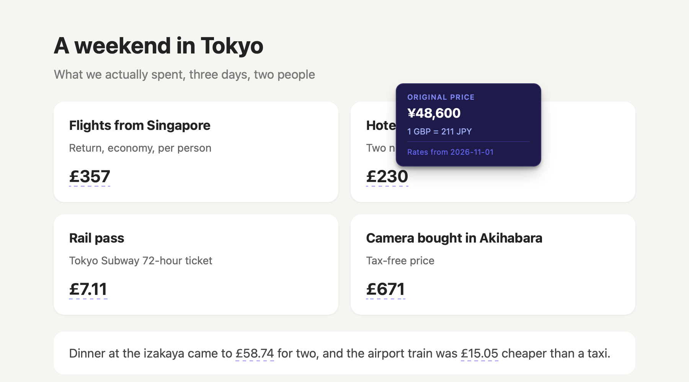
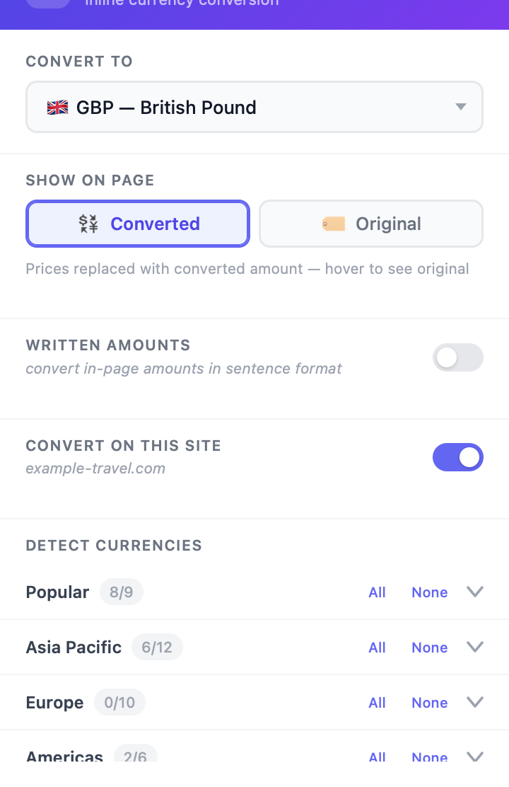

# Currenzy

A Chrome extension (Manifest V3) that converts prices into your currency right on the page.

- Detects currency amounts in page text and shows the converted value inline, with the original in a tooltip.
- Handles prices split across elements (e.g. `S$155`), shadow DOM, and single-page apps.
- Understands `1.200,00`, `1,200.00` and suffixes like `$1.5M`.
- Right-click selected text to convert it manually.
- Rates come from the free [fawazahmed0/currency-api](https://github.com/fawazahmed0/exchange-api) (no API key), refreshed daily and cached locally.

  
  

## Install

1. Download **[Currenzy.zip](https://github.com/capheproject/Currenzy/releases/latest/download/Currenzy.zip)** from the [latest release](https://github.com/capheproject/Currenzy/releases/latest) and unzip it somewhere it can stay (the browser loads it from that folder).
2. Go to `chrome://extensions` (or `edge://extensions`, `brave://extensions`, …).
3. Turn on **Developer mode**.
4. Click **Load unpacked** and pick the unzipped folder.
5. Optional: pin the extension to the toolbar.

It isn't on the Chrome Web Store, so the browser may remind you on startup that a developer-mode extension is installed. That's expected.

## License

MIT
